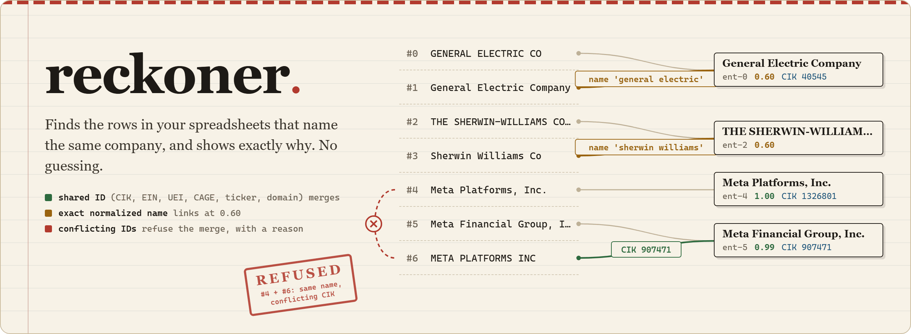
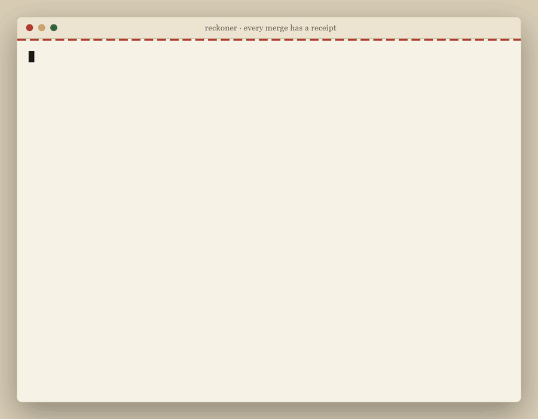
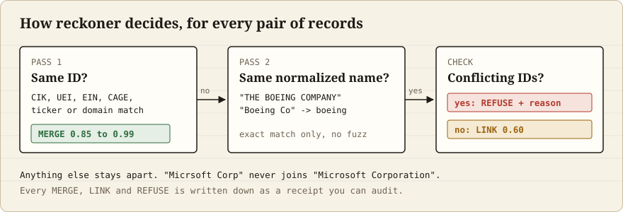

<p align="center"></p>

# reckoner

**Give it a list of company names from different sources, and it tells you which ones are the same company, and why.** It only merges on proof (a shared ID, or the exact same name once spelling noise is removed), never on a guess, and it writes down a receipt for every merge and every refusal.

```
pip install reckoner-er
```

The package is called `reckoner-er` on PyPI because `reckoner` there is an unrelated Helm tool, so `pip install reckoner` installs the wrong thing. The import name and the command are both `reckoner`. Do not install both packages in one environment. Python 3.9 or newer, no dependencies, ships `py.typed`.

<p align="center"></p>

## From Python

```python
from reckoner import resolve, match

clusters = resolve([
    "GENERAL ELECTRIC CO",
    "General Electric Company",
    {"name": "GE", "cik": "0000040545"},
    {"name": "General Electric", "cik": "40545"},
    "Boeing",
])
for c in clusters:
    print(c.canonical_name, c.members, c.link_confidence)
# General Electric Company (0, 1, 2, 3) 0.99
# Boeing (4,) 1.0

m = match("THE SHERWIN-WILLIAMS COMPANY", "Sherwin Williams Co")
m.matched, m.score, m.method   # (True, 0.6, 'name_exact_normalized')

match({"name": "Meta Platforms, Inc.", "cik": "1326801"},
      {"name": "META PLATFORMS INC", "cik": "907471"}).reasons
# ('identical normalized names but conflicting CIK - refusing to merge',)
```

Every `Cluster` carries its members, identifiers, confidence and an `explanations` sentence for every merge and refusal. Full reference: [docs/python-api.md](https://github.com/Mattbusel/reckoner/blob/v0.3.0/docs/python-api.md).

## From the command line

```bash
reckoner --demo                                  # see it work on a built-in example
reckoner vendors.csv                             # CSV, JSON or JSON Lines with a name column
reckoner vendors.csv -f csv -o resolved.csv      # your rows + entity_id, canonical_name, link_confidence
reckoner match "GENERAL ELECTRIC CO" "General Electric Company"   # exit 0 on a match, 1 otherwise
```

Recognised columns (case-insensitive): `name`, `agency`, `cik`, `uei`, `ein`, `cage`, `ticker`, `domain`, `source`, `state`. `--agency` handles government agency names (`DoD`, `EPA`, `U.S.` prefixes). `reckoner --help` lists every option.

## How it decides

<p align="center"></p>

- **Identifiers merge first.** A shared CIK, UEI, EIN, CAGE, ticker or domain merges two records outright. Registry IDs (CIK, UEI, EIN, CAGE) link at 0.97 to 0.99; reassignable ones (ticker 0.90, domain 0.85) lower.
- **Names link only on an exact match after conservative cleanup.** Case, punctuation, `&`, a leading `The`, and trailing legal suffixes (`Inc`, `Corp`, `LLC`, `L.P.`, `GmbH`, `plc`, ...) are removed. Distinguishing words are never dropped. Such links score 0.60.
- **No fuzzy scoring anywhere.** A typo does not match. There is no similarity knob to tune.
- **Conflicting registry IDs block a merge.** Same normalized name but different CIKs: refused, with the reason recorded.

On a committed snapshot of real GLEIF legal names (1312 entities, 2922 names), formatting variants resolve at precision 0.966 and recall 0.969. Renames and trade names are not linked, by design. Method and numbers: [docs/benchmark.md](https://github.com/Mattbusel/reckoner/blob/v0.3.0/docs/benchmark.md).

## Links

- Source, install scripts and prebuilt binaries (no Python needed): https://github.com/Mattbusel/reckoner
- Changelog: https://github.com/Mattbusel/reckoner/blob/main/CHANGELOG.md
- Issues: https://github.com/Mattbusel/reckoner/issues

MIT licensed.
